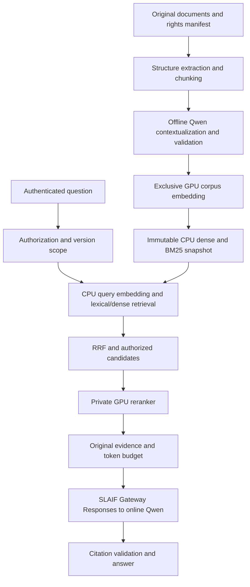

# SLAIF Raggedized Helper — product architecture

Revision: 1.0, 2026-11-01. Status: synthesized architectural baseline for development;
not implementation, hardware qualification, milestone acceptance, or deployment approval.
Canonical location: repository root. The strategic workspace links to this file.

## Authority and source reconciliation

The human supplied two specifications. `PLAN.md` preserves the older
`IMPLEMENTATION-PLAN.md` byte for byte. `docs/sources/IMPLEMENTATION-UPDATE-2026-11-01.md`
preserves the binding newer addendum byte for byte. Read them together; the addendum
wins every conflict. This architecture integrates their requirements without editing
either source. `SOURCE-MAP.md` distinguishes supplied requirements, reported installed
capabilities, proposed defaults, and unmeasured assumptions. Stable A01–A40 references
below define implementation and Independent Closure Audit (ICA) scope. The roadmap is
a decomposition of that scope, not a substitute for it.

### A01 — Product and boundaries (PLAN §§1,12; UPDATE §§1,12)

Build a locally operated documentation help service: expensive, restartable offline
contextual retrieval preparation; bounded online authorized retrieval and cited answers.
Users ask English or Slovenian technical questions, including exact commands, versions,
cross-language references, tables, and selected visual questions. Operators inventory,
ingest, evaluate, publish, roll back, and refresh corpora. Models never execute document
instructions or user shell commands. V1 excludes autonomous system modification, ticket
actions, GraphRAG, hierarchical summary indexes, fine-tuning, a hosted vector database,
cloud inference dependencies, Kubernetes, and an open-ended retrieval agent.

### A02 — Corrected hardware topology (UPDATE §§1–4,6,8)

Default online target: V100 32 GB; existing vision-enabled Qwen3.8-27B Q6 through SLAIF
Gateway, actual server context initially 32768, conservative parallelism 1; co-resident
FP16 BGE reranker in a private process; CPU FP32 BGE-M3 query embedding and CPU search.
Qwen's old ~190k V100/~100k RTX 3090 profiles remain preserved for offline work. A smaller
HTTP prompt cannot resize an already allocated server context. Q6 is the reference;
Q4 is an explicit evaluated alternative. V100 BF16 is not assumed. Do not infer free
VRAM from weight arithmetic, GPU sharing from ports, or co-location from GPU names.

The preferred deployment is conditional on peak-load qualification. Existing long-context
capability is human-reported and must be preserved; this bootstrap has not measured it.
No new GPU, SGI server, GTX 1080, or second host is a prerequisite. A measured fallback
may be selected under the same behavior/security contracts and documented explicitly.

### A03 — Small service composition (PLAN §§3,12; UPDATE §8)

Use Python 3.12+ as a proposed implementation baseline, a `src/slaif_raggedized_helper`
package, FastAPI, explicit typed schemas and interfaces, and a thin CLI. Pin the actual
supported Python/dependency versions during foundation work. Avoid a large RAG framework.
Separate logical ownership: API/retrieval process; long-lived private reranker worker;
offline preprocessing worker; existing externally operated Qwen and gateway services.
One service process may compose CPU components. Process separation controls GPU lifetime;
it is not a requirement for a distributed service mesh. Local files and locks suffice
for metadata at the intended tens-of-thousands-of-chunks scale; no database service in v1.

### A04 — Licenses and model provenance (PLAN §§2–3; UPDATE §9 LICENSE-01)

Retain Apache-2.0 for project code. Select direct application/model/tokenizer components
under MIT, BSD, or Apache-2.0; inventory exact SPDX identifiers and immutable revisions.
Do not automatically expand this policy. Python/PSF and NVIDIA CUDA/driver terms are
explicit platform disclosures, not mislabeled application licenses. Record full transitive
native/wheel dependencies, SBOM and THIRD_PARTY_NOTICES; unknown or unapproved components
block distribution. Inspect PDFium binary dependencies before enabling/shipping rendering.
Source rights and evaluation fixture licenses are separate checks. Record GGUF, projector,
source checkpoint and quantizer provenance, hashes, runtime build, KV, MTP and startup
configuration. Human-approved platform exceptions never imply a blanket legal approval.

### A05 — Source identity, rights and inventory (PLAN §§5,6.1,10)

An approved ingestion manifest identifies logical document ID, immutable content/revision
hash, canonical source URI, title, product, authority, effective date/version, language,
ACL partition, extraction policy, and rights. Discover a representative 200–500-page pilot;
10,000 pages and 20,000 chunks are capacity examples, not measured inventory. Deduplicate
bytes without merging distinct source/ACL provenance. Ingestion uses allowed local roots
or explicitly allowed domains; no arbitrary network crawling, redirects, or path traversal.

### A06 — Structural extraction (PLAN §6.2)

Prefer native text/Markdown and pdfminer.six native PDF extraction. Preserve original
paragraphs, headings, list nesting, code, tables, units, captions, reading order and anchors.
Detect recurring page furniture without deleting safety/version notices. Keep normalized
search text separate. Resource-limit extraction and read sources without modification.

### A07 — Blocks, chunks and original evidence (PLAN §5)

Blocks retain document revision, deterministic ID, kind/order, page/section anchor, native
versus vision-derived origin, and actual bounding boxes only when known. Chunks retain
exact original text and source spans, heading path, pages, language/version, ACL, neighbors,
separate generated annotation, annotation support blocks and mode, validation state,
per-tokenizer counts, and all processing fingerprints. Never manufacture coordinates or
cite a generated annotation as original evidence. Include supporting original spans when
an annotation resolves a referent outside the target chunk.

### A08 — Independent token accounting (PLAN §4; UPDATE §§3,6)

Use serving GGUF/template tokenization for generator input and output reserves; separately
account actual vision overhead. Pinned HF tokenization is an estimate until parity is
verified. Use exact BGE-M3 tokenizer/official CLS pooling for embedding budgets; exact
reranker tokenizer for complete query/passage pairs. BM25 uses its own technical-text
lexical analyzer. Persist identities/counts separately. Reject or deliberately split
oversize input; no silent truncation of original facts, versions or warnings.

### A09 — Structural chunk budgets (PLAN §6.3)

Initial tunable defaults: 512 BGE-token body target, 768 soft body maximum, up to 64
overlap tokens only where useful, enriched text ≤1024 BGE tokens including specials.
Reranker starts at a validated 768 or 1280 pair-token cap. Keep procedures with warnings;
split tables by rows and repeat original headers/units; preserve coherent code. If enriched
text overflows, shorten annotation or split/recontextualize the original, never trim its
tail. Page boundaries provide provenance rather than compulsory chunk boundaries.

### A10 — Contextual retrieval algorithm (PLAN §§6.4–6.5)

Contextualize one coherent parent document at a time, not the corpus. Stable metadata and
parent prefix precede the varying target chunk suffix. Do not feed earlier annotations
back into later jobs. Generate a brief source-language annotation resolving subject and
referents, preserving identifiers, exceptions, numbers and negation. Request structured
`context`, `support_block_ids`, `needs_review`; target 50–100 Qwen output tokens, cap around
160, low temperature and tested non-thinking mode. These are defaults, not guaranteed
determinism or capabilities. Use whole parent when within measured template/image/output
budget; illustrative parent limits 160k V100/80k RTX. For larger parents use coherent
sections plus original cross-references and label `section_plus_references` explicitly.

### A11 — Annotation validation (PLAN §6.7)

Validate schema, length, source block existence, same document/version, ACL support,
identifier/number/version/negation preservation and review flags. Such checks do not prove
entailment; inspect representative and high-risk samples and optionally use a constrained
verification pass. Bounded retries end in an explicit rejected annotation with original-only
retrieval, never fabricated replacement evidence. Enrichment inherits the most restrictive
permissions of every supporting source block; public chunks cannot launder private context.

### A12 — Resumable jobs and invalidation (PLAN §§5,6.7; UPDATE §§3,9 OPS-01)

Content-address job keys by parent revision, target spans, extraction/chunking policy,
GGUF/projector hashes, prompt, generation parameters and adapter identity. A changed parent
invalidates dependent contexts even if the target text is unchanged; selective invalidation
requires a proved dependency graph. Persist each accepted/rejected annotation and completed
embedding batch atomically with checksum, fingerprint and state. Retries/restarts reuse
unchanged completed work without duplicate outputs. KV/recurrent cache is disposable;
annotations, provenance and job records are durable.

### A13 — Generator boundary (UPDATE §5)

Define one semantic `GeneratorClient` interface for context annotation, visual extraction,
and answer generation, with optional images, structured output intent, output/sampling
bounds and explicit capabilities. Results include text/items, actually available usage,
timings, adapter/model fingerprints and safe failures. Wire formats may differ. Unavailable
metrics remain unavailable, never zero or invented. No document-supplied tools or endpoints.

### A14 — Gateway online contract (UPDATE §§1,5.2; GATEWAY-01/02/03)

`SlaifResponsesGenerator` is the online default and calls configured SLAIF Gateway
`POST /v1/responses`. Inspect and pin the actual gateway commit/contracts, route/upstream
profile and a successful authorized request before qualification. Do not guess host, route,
key, schema mode, vision support, streaming, cache hints or unlimited Responses parity.
Parse all applicable output text items; test non-streaming and route-supported streaming,
cancellation/errors and actual usage/accounting. Bounded timeout/retry rules must not replay
an ambiguously completed expensive generation blindly. Secrets stay in environment/secret
files and never URLs/prompts/logs. Do not modify the gateway project for convenience.

### A15 — Direct offline adapter and cache proof (PLAN §6.6; UPDATE §5.3–5.4)

`DirectLlamaGenerator` is explicit trusted offline opt-in or scoped diagnostics, privately
bound and access-controlled. Native `/completion` cache_prompt/id_slot only when the exact
build supports them. Never forward them blindly through gateway Responses. No fallback
from denied or failed gateway requests to direct online inference. Do not expose slots,
props, model/process controls. Compare semantic output with gateway on identical parents.
Measure cold/warm actually evaluated prompt tokens and prefill time at 8k/32k/80k/near-budget,
with vision, MTP, same tokenized template, hybrid-state correctness and restart/restore.
Low latency alone is not proof of prefix reuse. Preserve the known-working runtime;
accept slower correct work or separately evaluate bounded multi-chunk batching before
patching runtime behavior. Gateway routing offers no assumed slot affinity.

### A16 — Embedding-space contract (PLAN §§3,6.8; UPDATE §6.1 EMBED-01/02)

Pin BAAI/bge-m3 revision, tokenizer, official CLS pooling, L2 normalization and text template.
Use dense 1024-dimensional output only. Online query encoder is resident CPU FP32. Offline
corpus embedding uses exclusive GPU FP16, then FP32 stored normalized vectors, with CPU
FP32 reference. Compare cosine agreement, score/rank stability and Recall@k before mixing
compute precisions. If unsuitable, use tested GPU FP32 or separately validated inference.
Model/space changes require an entire compatible snapshot; equal dimensions do not imply
compatible spaces. Qwen generator hidden states are not embeddings. Alternative
Qwen3-Embedding-0.6B and ONNX/INT8 remain evaluated optimizations with rollback.

### A17 — Lexical and dense retrieval (PLAN §§4,6.8,7)

Index trusted headings + accepted context + original text for dense and independent bm25s.
Also retain raw-only variants for controlled ablation. Lexical analysis preserves whole
technical identifiers and useful components, flags, paths, dotted/underscored names,
versions and negation; no indiscriminate English stemming for Slovenian. Start exact CPU
normalized FP32 matrix/dot product; FAISS IndexFlatIP only when beneficial. No ANN/vector
service without evidence. ACL-scoped candidate scoring precedes downstream exposure.

### A18 — Immutable snapshots (PLAN §§5,6.8,10)

Store original artifacts separately from versioned chunks/contexts/embeddings. Snapshot
manifest binds dense matrix, lexical data, row map, chunks, model/policy/source hashes,
ACL and deletion completeness. Verify counts, unique IDs, finite normalized vectors, checksum
and model-space match plus retrieval smoke before publication. Exclusive writer, temporary
files, appropriate fsync and atomic pointer replacement; each reader pins one complete
snapshot for its request. Missing, corrupt, incompatible or unaudited snapshots fail closed.
Never deserialize untrusted pickle. Rollback preserves compatible evidence and ACL policy.

### A19 — Fusion and candidate accounting (PLAN §7)

Start 60 dense + 60 BM25 candidates, deduplicate and use RRF sum(1/(60+rank)), then rerank
top 40 and select roughly 6–10 evidence chunks. All counts are tunable. Never sum raw BM25
and cosine scores. Measure recall lost at every cap/fusion stage. Preserve source/version
identity; use overlap deduplication and diversity only when evaluation supports them.

### A20 — Reranker worker (UPDATE §§3,4,6.2; RERANK-01)

Pinned BAAI/bge-reranker-v2-m3, V100 FP16, private resident worker, initial batch 4 with
measured 1/2/4/8 sweep and configurable candidate count, pair cap, timeout, queue and device.
Score contextualized passages, return ordered IDs and timings; scores are not truth or
confidence probabilities. CPU FP32 regression subset establishes ordering/quality reference.
Probe loaded/warm readiness, cancellation, bounded queued/in-flight batches and restart
isolation. Preserve evidence facts while meeting pair caps. Do not load the embedder on
the online GPU simply because both checkpoints share the BGE name.

### A21 — Evidence assembly (PLAN §7)

Supply original source spans and minimum trusted metadata, including original support for
annotation-resolved references. Enforce ACL/version again during expansion. Deduplicate
overlap; retain warnings, commands, units and uncertainty. Budget with actual generator
tokenizer: initial 4k–6k source tokens, ≤12k total input including bounded history/instructions,
~1536 output reserve, within actual configured context including vision. Context capacity
is not a target to fill. If required evidence cannot fit, report insufficiency rather than
truncate facts or exceed a backend limit.

### A22 — Answering and conversation limits (PLAN §7; UPDATE §6.3)

One normal gateway Qwen answer call; answer in user language, preserve exact identifiers,
distinguish versions and state insufficient/contradictory evidence. Standalone queries do
not require an extra rewrite. Unresolved conversational referents allow one bounded rewrite
or clarification; at most one additional retrieval round for an identifiable evidence gap,
with total request/token/time limits. Retrieved text is data, never authority. Validate
citation IDs and authorization; separately evaluate claim support. Source-only results are
an explicitly separate API outcome, not a fabricated answer on generator failure.

### A23 — Authenticated API and source serving (PLAN §§10,12; UPDATE §5.2)

Proposed routes: `/healthz`, `/readyz`, `/v1/search`, `/v1/answer`, authenticated source/citation
and original-image retrieval. Search returns chunk/spans/snapshot/scores/timings. Answer
returns answer or qualified stream plus citation records and bounded diagnostics. Define
exact schemas in an ordered contract before implementation. Search and answer require a
validated principal and server-owned authorized corpus/version scope; caller filters only
narrow it. V1 proposed auth is an operator-configured bearer-to-scope mapping with hashed
token verification and secret-file loading; no unauthenticated default, public signup,
tenant-admin UI, or new identity provider. Test missing/invalid/revoked identity and scope
confusion. Upstream gateway identity is separate from application user authorization.
Administrative indexing/activation runs via private CLI, never a public management API.

### A24 — Authorization and cache isolation (PLAN §10)

Use access-partitioned indexes in v1, or prove authorized-matrix filtering before scoring.
No unauthorized text reaches reranker, generator, neighbor expansion, caches, diagnostics,
citations or images. Source endpoints resolve backend-validated identifiers, never model
paths/URLs. Recheck current authorization at retrieval and source serving; snapshot rollback
cannot revive revoked access. Cache keys include principal/scope-policy revision, question,
model fingerprint and snapshot; never share private results on question alone.

### A25 — Extraction/model isolation (PLAN §§6,10)

Untrusted documents/queries cannot supply instructions, credentials, tools, network targets,
or executable payloads. Read-only original mounts, allowlisted ingestion, file/type/size/time
limits and resource-limited parsers; no pickle, traversal, arbitrary SSRF or unbounded image
decode. Prompts/delimiters aid parsing but do not constitute a security boundary. The
application offers no model-operated shell/network tools. Output escapes are required at
presentation boundaries. Synthetic adversarial fixtures exercise these refusals.

### A26 — Privacy and observability (PLAN §10; UPDATE §§5,6)

Corpus storage is deliberate source storage with rights/ACL/retention policy. Query/answer
and prompt full-text logging is off by default; diagnostic capture is explicit, time-limited
and access-controlled. Redact tokens, private paths/URLs, source/query content and credentials
from public reports and routine logs. Record safe request/job IDs, snapshot/fingerprints,
stage timings, queue wait, usage availability, rejection/degradation reason, retry/failure
counts and resource metrics. Error responses disclose no secrets or unauthorized existence.

### A27 — GPU ownership and transitions (UPDATE §§3,8; OPS-02)

Model explicit states online_rag_v100, offline_context_long, offline_embed_gpu plus draining,
starting, recovering and failed states. Lock ownership by physical host/GPU identity with
owner/process incarnation and durable transition journal. Do not assume lockfile existence
means an owner is alive or delete an unknown owner's lock. A bounded maintenance transition
drains/rejects new requests, preserves in-flight work to timeout, unloads owned reranker/Qwen,
verifies vacancy, runs/resumes jobs, then restores prior known profile and health-checks.
Never kill unknown processes or restart an incompatible profile after failure. Recovery
failure stays visible/not ready; completed job artifacts survive. Separate hosts can work
concurrently under separate GPU ownership; transfer artifacts with integrity checks.

### A28 — Readiness, admission and concurrency (UPDATE §§4,6,8; ONLINE-02)

Open readiness only after profile ownership, correct Qwen context/projector and gateway
route, measured co-resident warm-up/margin, CPU embedder-space/snapshot match, ACL and citation
smokes. Distinguish health from loaded-model readiness. Bound HTTP concurrency, queues,
reranker/GPU work, timeouts and cancellation. Protect llama.cpp host threads with CPU budgets.
For >1 user test queue wait, overlapping Qwen/reranking, OOM, lockup, cancellation and recovery.
Configured explicit lexical-only or RRF-only degradation must be labeled and evaluated;
required-mode failure makes readiness false or returns an honest failure. No hidden direct
generator fallback, unbounded restart loop, or fake cache/usage result.

### A29 — Memory/latency qualification (UPDATE §§4,6.4,9)

Run V100 Q6 vision 32k alone, then reranker FP16 batches 1/2/4/8 at worst permitted length
and concurrent workload. Measure startup/warm/peak GPU allocations, allocator reserved/used,
RSS, exact GGUF/projector/KV/MTP/build/slots, TTFT, decode, stage p50/p95/max, power/utilization,
queue waits and restart repeatability. Initial peak spare-memory target ~2 GiB is a test
target, not observed fact. If needed test 24k/16k, bounded slots/buffers, Q4 quality A/B, then
measured CPU/separate-GPU fallback; optional 48k/64k only with benefit and margin. Measure
actual production CPU embeddings and reranking 10/20/40/80 candidates at multiple lengths.
Set service latency/concurrency targets after baseline evidence, never invent a guarantee.

### A30 — Optional visual ingestion (PLAN §6.2; UPDATE §§5,9 GATEWAY-02)

Enable PDF rasterization only after exact wheel/native license audit. Use targeted Qwen
vision for scanned or irrecoverable text, tables and diagrams, once per page/crop. Preserve
original images, source anchors and extraction uncertainty. Request literal transcription,
units, labels/connections, unreadable markers; separate observation from interpretation.
No fabricated bounding boxes or silent elevation of visual descriptions to native evidence.

### A31 — Visual answers (PLAN §7; UPDATE §10 E)

Retrieve page/crop by its textual representation, authorize originals, then attach only a
bounded number of original images to a qualified gateway vision request. Count actual image
overhead at 32k online allocation; test size/count/error behavior and visual/numerical claim
support. This is text-first multimodal retrieval, not a dedicated image-vector system.
Text-only core can be demonstrated separately; full visual milestone remains unproven until
license, route capability and quality evidence exist.

### A32 — Evaluation data and held-out discipline (PLAN §§6.1,11)

Begin human-written representative questions and expand to a few hundred; synthetic items
supplement, never substitute for the human set. Store gold original spans, acceptable facts,
disallowed claims, answerability, language, version and ACL. Cover exact errors/commands,
Slovenian over English, contradictions, tables/diagrams, follow-ups and unanswerable requests.
Keep final held-out questions out of tuning. Private datasets stay outside public Git.

### A33 — Retrieval and answer ablations (PLAN §11; UPDATE §9)

Hold extraction/chunking constant for raw BM25, raw dense, raw hybrid, contextual hybrid,
contextual+reranker; evaluate Q4/Q6 annotations, alternative embedder and vision off/on as
explicit variants. Track source Recall@20/60, multi-source complete evidence, MRR/nDCG,
candidate loss, factual/citation support, exact commands, abstention, language and latency.
Initial proposed target ≥95% single-source held-out Recall@20, separately report multi-source;
zero observed ACL leaks/invalid citations/silent truncation in release tests; meaningful
enrichment/reranker benefit and no material optimization regression. Thresholds/uncertainty
must be declared before selecting results. Humans inspect errors and sampled annotations;
classify failures by extraction/chunk/context/retrieval/rerank/packing/generation/version/ACL.

### A34 — Corpus updates, deletion and recovery (PLAN §§5,10,12)

New source revisions trigger dependency invalidation and rebuild of affected artifacts;
deleted/revoked records must not survive a newly activated snapshot or source-serving policy.
Use tombstones/retention-aware cleanup as a proposed reversible implementation default;
hard purge of irreplaceable originals is a human-controlled action. Prove interrupted writes,
crash recovery, concurrent-reader consistency, checksum refusal, update/delete propagation,
backup restore and rollback without resurrecting access. Restore tests use disposable data.

### A35 — Configuration and operators (PLAN §12; UPDATE §§7–8)

Separate profile files and explicit environment-secret references for gateway/direct route,
physical host/GPU, model fingerprints, precision, batch/queue/time bounds, token budgets,
snapshot root, allowed source roots, ACL mapping and degradation policy. Do not invent live
hostnames, ports, model IDs or credentials. Desired context is a supervisor expectation,
not an HTTP option that resizes Qwen. Proposed CLI: doctor, ingest, chunk, contextualize
--resume, build-index, evaluate, activate, serve, plus explicit profile/drain/restore commands.
Only document commands as available after code/tests exist. Provide private local deployment
examples, health, upgrade/rollback and recovery runbooks without touching existing services.

### A36 — Early qualification gates (UPDATE §§9–10)

A0 inventories current gateway/route and reported GPU/runtime profiles without changing
them. A1 creates/runs named GATEWAY-01/02/03, DIRECT-01, V100-MEM-01/02, RERANK-01,
EMBED-01/02 with actual artifacts and authorized bounded infrastructure access. ONLINE-01/02
and OPS-01/02 follow the implementation they exercise; LICENSE-01 spans the lifecycle.
Mock protocol proofs and harness tests are separate from real qualification. Missing hardware,
access or samples yields BLOCKED/NOT RUN, not a guessed pass. Safe independent pure-software
work may proceed if the roadmap explicitly preserves blocked topology/readiness gates.

### A37 — Test and publication honesty (PLAN §11; UPDATE §11)

Each behavior slice includes meaningful positive/negative tests, docs and exact evidence.
Default tests use synthetic fixtures/fake model clients and require no secrets, GPUs, downloads
or provider calls. Opt-in integration/benchmark markers name host/model/revision/scope.
Focused local tests normally; broad checks at phase/release or to reproduce their failure.
Skipped, missing, pending and environment-blocked checks never pass. Record current merged
revision and raw safe metrics; example arithmetic (~82 MB vectors, generation estimates)
cannot become measured capacity. Installed capabilities are distinct from claims in model cards.

### A38 — Concentrated OAP authority and provenance

Human owns product, risk, adjudication and deployment. Strategy owns architecture/work orders,
independent evidence review and conditionally delegated development merge. Coding owns bounded
implementation and Git publication, never merge or roadmap. Separate persistent strategic role
and task-local coding context; reconstruct from GitHub plus durable orders/reports. Each order
traces to H human preload, A architecture, E observed evidence, I audit or C DHA remediation.
One objective/PR; correction suffixes remain on it. All D1 judgment debt is strategically authored
and recorded before merge, never dumped into CRITICAL as routine TODOs. No product activation
is implied by this bootstrap. See the role constitutions and protocol for execution law.

### A39 — Readiness, DHA and closure audit

Separate scaffold validation, operational activation readiness, synthetic demonstration,
text-core MVP, full visual MVP, controlled pilot and production. A finished queue or green CI
does not certify a milestone. ICA evaluates full A01–A40/source scope at exact merged revision,
classifying IMPLEMENTED/PARTIAL/ABSENT/UNPROVEN with code, runtime, negative tests and limits.
Use an independent reviewer/context with scoped skeptical instructions; this author's own
review is not ICA. Reaudit relevant changes after remediation. Human dispositions clear only
their registered gates; release/deployment also needs explicit scoped human authority.

### A40 — Protected resources and non-delegable actions

This project does not own other repositories, existing Qwen/gateway services, operator
credentials, real corpora, production GPUs or shared processes. Read-only contract inspection
is permitted; service changes, real inference/large downloads, sensitive data ingestion,
external exposure, risky license exceptions, destructive data actions and release need an
explicit bounded authorization for that boundary. A valid activation permits ordinary
development continuation and safe disposable tests, not those actions. Never copy agent
authentication/history, change the human-selected model/provider, or use tmux as an alternate
order channel. Recovery may inspect the designated coding pane sparingly and resume the same
logical objective; deliberate human quit is respected.

## Supersession and implementation ordering

UPDATE §2 replaces the old generic/direct online assumption, CPU-only production reranking,
optional-only GPU embedding, and oversized online server allocation. CPU query encoding,
source truth, ACLs, original citations, structural chunking, immutable snapshots, independent
tokenizers, licensing and evaluation remain. No old statement overrides these corrections.

The dependency program is in `oap/strategic-instructions/INITIAL-ROADMAP.md`. Its earliest
orders publish governance, inventory environment, build qualification interfaces, and test
feasibility before committing deployment assumptions. Then provenance/chunking, raw retrieval,
evaluation, contextualization, reranking, evidence/answers, lifecycle, vision, hardening and
ICA. Hardware-dependent gates remain visible if execution access is unavailable.
